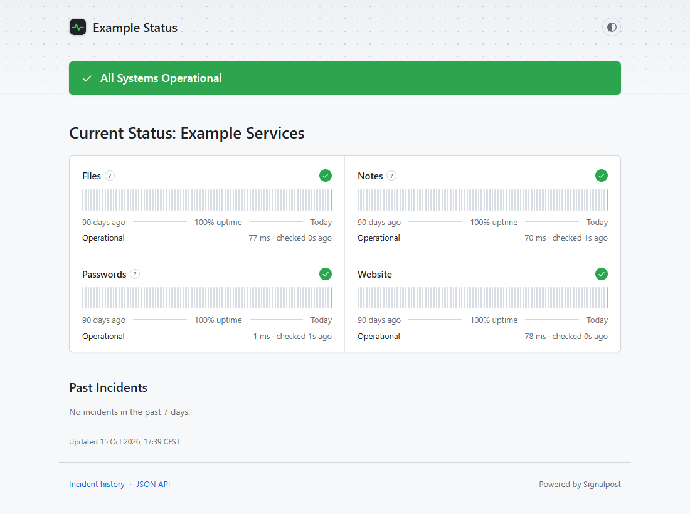
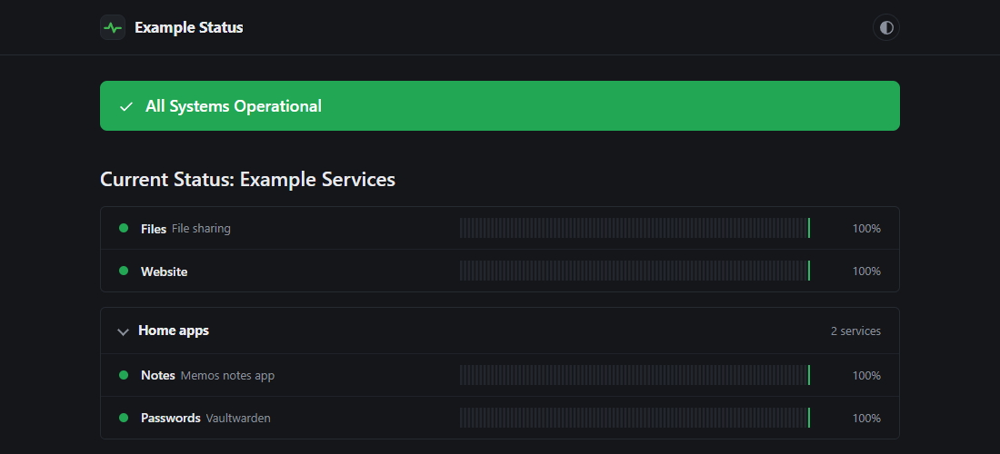
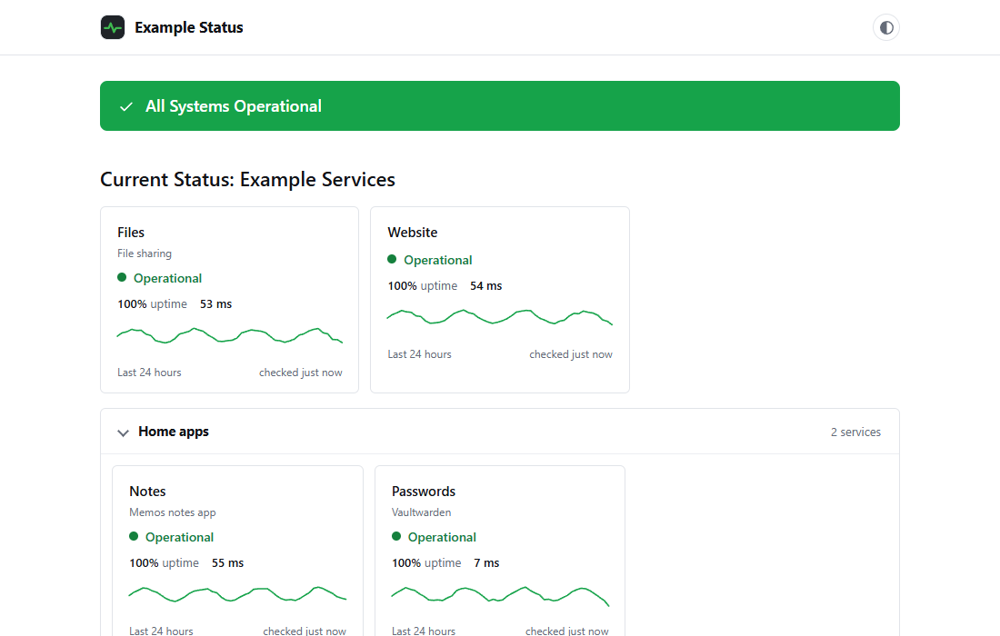
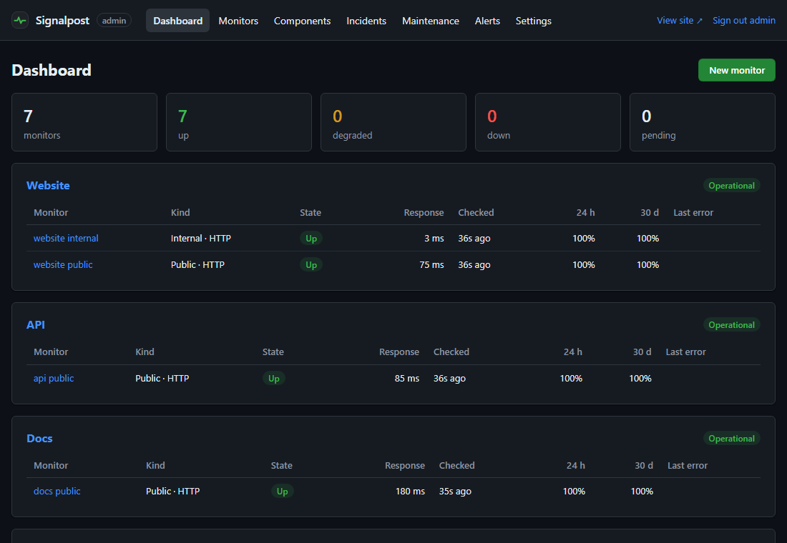

# Signalpost

[](https://github.com/VikkarDev/Signalpost/actions/workflows/ci.yml)

A small self-hosted status page with built-in uptime monitoring. One container, one SQLite file, no external services.

It checks your services over HTTP, TCP or ping, keeps 90 days of history, and shows it on a public page in the style of the big hosted status pages. There's an admin area for monitors, incidents, maintenance windows and alerts (Discord, ntfy push, webhooks and email).

I built it to run on a Synology NAS behind Cloudflare Tunnel, but it runs anywhere Docker does.



## Features

- Public status page with overall banner, per-service history bars (30, 60 or 90 days) and uptime percentage. It updates itself without reloading, and "checked 12s ago" counts up live. Hover a day to see how long it was down, which incidents it had, and links to them.
- A service that failed recently shows as "Recovered" for a while instead of plain green, and a monitor that stops reporting gets its time marked "(late)", so the page never looks fine just because nothing is being checked.
- Group related services into collapsible sections, upload your own logo, and add footer links.
- Light and dark theme (follows your system, or pick one), and both the status page and the admin area work on phones.
- HTTP(S), TCP and ping checks. Configurable interval, timeout, expected status codes, keyword match, "slow" threshold and how many failures in a row count as down.
- Separate **internal**, **public** and **canary** checks, so you can tell "the app is down" apart from "the tunnel/DNS/internet is down" (more below).
- Incidents with a public timeline, and maintenance windows that pause alerts and don't count against uptime.
- Alerts to Discord, your phone (via [ntfy](https://ntfy.sh)), any JSON webhook and email, with rules per event type, per service and optional reminders while something stays down. Also warns before TLS certificates expire.
- RSS/Atom feed of incidents and maintenance at `/feed.xml`, and a read-only JSON API at `/api/v1/status`.
- Small footprint: about 30-60 MB RAM, a single dependency (nodemailer), Node 24's built-in SQLite.

### Layouts

Pick one under **Settings → Display**. Besides the grid above, there's a compact list and cards with a 24-hour response graph.

| Compact list (dark theme) | Cards |
|---|---|
|  |  |

### Admin



## Quick start

```bash
git clone https://github.com/VikkarDev/Signalpost.git signalpost && cd signalpost
# edit docker-compose.yml: set ADMIN_PASSWORD and PUBLIC_URL
docker compose up -d --build
```

Open `http://localhost:3000` for the status page and `http://localhost:3000/admin` to log in.

The admin account is created on first start from `ADMIN_USERNAME` / `ADMIN_PASSWORD`. After that the env var isn't used anymore, so you can change the password in Settings and remove it from the compose file.

Data is stored in the `signalpost-data` volume and survives restarts and updates.

## How the checks fit together

**Components** are what visitors see ("Website", "Files", "API"). **Monitors** do the actual checking and belong to a component. Every monitor has a scope:

- **internal**: talks to the service directly, e.g. `http://my-container:8080` on the Docker network or a LAN IP. Tells you whether the app itself works.
- **public**: goes through the same path as your visitors, e.g. `https://files.example.com` via DNS, Cloudflare and the tunnel.
- **canary**: something that should always be up, like `https://1.1.1.1` or ping `8.8.8.8`. If all canaries fail, the server has lost its internet connection.

When something breaks, the admin dashboard uses these to tell you where:

| internal | public | canaries | you'll see |
|---|---|---|---|
| down | - | - | Application failure |
| up | down, Cloudflare 52x/530 | up | Cloudflare / tunnel problem |
| up | down, DNS error | up | DNS problem |
| up | down, other error | up | Problem between the internet and your server |
| - | down | all down | The server's internet connection is down |

You don't have to use internal checks, but if you only check the public URL you can't tell these cases apart.

### Uptime and history

Uptime is `(up + slow) / all checks`. It's only calculated from checks that actually ran, so a new monitor shows "No data yet" and grey bars until data comes in. Checks during maintenance are stored but left out.

A component's uptime is its worst monitor's uptime. Canaries are never counted.

Bar colours per day (defaults, all adjustable under **Settings → Display**):
- green: no failures
- yellow: some slow responses
- orange: below 100% (any failed check)
- red: below 99%
- blue: maintenance only
- grey: no data

Under **Settings → Display** you can also:
- switch the public page between three layouts: the grid, a compact list (one row per service), or cards with a 24-hour response-time graph
- choose 30, 60 or 90 days of history
- decide whether slow responses count as up
- set how long a service shows as "Recovered" (yellow) after it failed and came back up, or turn that off
- hide the uptime %, response times, "checked x ago" or component descriptions from the public page

Individual check results are kept for 14 days (`RAW_RETENTION_DAYS`). The daily totals behind the bars are kept for 400 days.

## Running on a Synology NAS

This works with Container Manager on DSM 7.2 and doesn't need SSH.

1. On GitHub, click **Code → Download ZIP**.
2. In **File Station**, create the folder `docker/signalpost` and upload the zip into it.
3. Right-click the zip and choose **Extract → Extract here**. That creates a `Signalpost-main` folder.
4. Open `Signalpost-main`, select everything, and **Move to** `docker/signalpost`. Then delete the empty folder and the zip.

   `Dockerfile`, `src/` and `public/` must sit directly in `docker/signalpost`. Uploading files one by one with the Upload button often leaves the folders behind, and the build then fails.
5. Open **Container Manager → Project → Create**:
   - Name: `signalpost`
   - Path: `/docker/signalpost`
   - Source: *Use existing docker-compose.yml*
6. Edit the compose file in the editor that opens. At minimum set `ADMIN_PASSWORD`, `PUBLIC_URL` and `TZ`.
7. Click through to **Done**. Container Manager builds the image (a couple of minutes the first time) and starts it.
8. Under **Container**, `signalpost` should show as running and, after about 20 seconds, healthy. The **Log** tab should show `http server listening` with the port it's using.

To change settings later, open the project, edit it under **YAML Configurations**, and run **Action → Build**. Restarting the container alone keeps the old settings.

The app runs as UID 1000. The named volume in the compose file handles permissions for you. If you'd rather use a folder (`./data:/data`) so Hyper Backup can see it, give UID 1000 write access to that folder, or the container will log that `/data` isn't writable.

## Behind Cloudflare Tunnel

If cloudflared runs as a container, put Signalpost on the same Docker network as cloudflared. The tunnel then reaches it by container name, and you don't need to publish a port at all.

Here's a complete compose file for that. Replace `my-tunnel-network` with the network your cloudflared container is on (Container Manager → Network shows them):

```yaml
name: signalpost

services:
  signalpost:
    build:
      context: .
    image: signalpost:1.2.9
    container_name: signalpost
    restart: unless-stopped
    init: true
    environment:
      ADMIN_USERNAME: admin
      ADMIN_PASSWORD: a-long-random-password
      PUBLIC_URL: https://status.example.com
      TZ: Europe/Stockholm
    volumes:
      - signalpost-data:/data
    networks:
      - my-tunnel-network
    read_only: true
    tmpfs:
      - /tmp:size=16m
    cap_drop:
      - ALL
    security_opt:
      - no-new-privileges:true
    sysctls:
      net.ipv4.ping_group_range: "0 2147483647"
    mem_limit: 256m

volumes:
  signalpost-data:
    name: signalpost-data

networks:
  my-tunnel-network:
    external: true
```

`networks:` appears twice on purpose. The one inside the service says which network to join. The one at the bottom, at the left margin, says that network already exists. Indent with spaces, not tabs.

Then in the Cloudflare dashboard, under **Zero Trust → Networks → Tunnels → your tunnel → Public Hostname → Add**:

- Subdomain/domain: e.g. `status` / `example.com`
- Path: empty
- Service: `HTTP` (not HTTPS), URL `signalpost:3000`

If you set `PORT`, use that port in the URL instead. It has to match the port in the container log line `http server listening`.

I'd also recommend putting **Cloudflare Access** in front of the `/admin` path (Access → Applications → Self-hosted, path `admin`). That gives the admin area a second login without touching the public page.

The app reads the visitor IP from `CF-Connecting-IP`. If the port is also published on your LAN, see the note in [SECURITY.md](SECURITY.md).

## Setting things up

A typical setup for one service:

| Monitor | Type | Scope | Target |
|---|---|---|---|
| files public | HTTP | public | `https://files.example.com` |
| files internal | HTTP | internal | `http://filebrowser:80` |
| NAS DSM | TCP | internal | `192.168.1.10` port `5001` |
| cloudflare canary | HTTP | canary | `https://1.1.1.1` |
| google canary | Ping | canary | `8.8.8.8` |

Defaults that work well: 60 s interval, 10 s timeout, 2 failures before down.
- For apps behind a login page, allow `401` in the expected status codes.
- Only tick "ignore TLS errors" for internal services with self-signed certificates.

To group services on the public page, give components the same **Group** name (e.g. "Home apps"). Your logo and footer links are under **Settings**.

To follow incidents in Discord without alert rules, point any RSS bot at `https://your-status-page/feed.xml`.

### Alerts

Add rules under **Alerts → New rule**. **Send test** on a rule confirms it works.

- **Discord**: create a webhook in your server (Server Settings → Integrations → Webhooks) and paste the URL.
- **ntfy (push to your phone)**: install the ntfy app, subscribe to a topic, and use the topic URL as the destination, e.g. `https://ntfy.sh/kitchen-nas-7f3k`. Topics on ntfy.sh are public to anyone who knows the name, so pick something hard to guess, or run your own ntfy server and put an access token in the token field. Downtime arrives as an urgent notification, recoveries as normal ones, and tapping it opens the monitor.
- **Webhook**: any URL that accepts a JSON POST, such as Home Assistant, n8n or a Slack/Mattermost incoming webhook. An optional token is sent as `Authorization: Bearer …`. The body looks like this:

  ```json
  {
    "site": "Status",
    "event": "down",
    "kind": "down",
    "title": "Nextcloud is down",
    "message": "Connection refused",
    "url": "https://status.example.com/admin/monitors/3",
    "fields": { "Monitor": "Nextcloud", "Component": "Cloud", "Check": "HTTP (internal)" },
    "sent_at": "2026-10-17T11:30:16.892Z",
    "text": "Nextcloud is down\nConnection refused"
  }
  ```

  `event` is one of `down`, `recovery`, `degraded`, `reminder`, `tls_expiry`, `incident_created`, `incident_updated`, `incident_resolved`, `maintenance` or `test`. `text` is there for Slack-style webhooks that only read that field.
- **Email**: needs the `SMTP_*` settings below.

## Configuration

Everything is set through environment variables. Only `ADMIN_PASSWORD` is needed, and only on the first start.

| Variable | Default | |
|---|---|---|
| `ADMIN_USERNAME` | `admin` | Initial admin username |
| `ADMIN_PASSWORD` | | Creates the admin account if none exists. Min. 12 characters |
| `ADMIN_RESET_PASSWORD` | `false` | Set to `true` once to reset the admin password to `ADMIN_PASSWORD` |
| `PUBLIC_URL` | `http://localhost:3000` | Used in alert links and the checker's User-Agent |
| `TZ` / `STATUS_TIMEZONE` | `UTC` | Timezone for day boundaries and displayed times. `STATUS_TIMEZONE` wins if both are set |
| `SITE_NAME` | `Status` | Initial site name (can be changed in Settings) |
| `PORT` | `3000` | |
| `DATA_DIR` | `/data` | Where the database is stored |
| `LOG_LEVEL` | `info` | `debug` logs every check |
| `SESSION_TTL_HOURS` | `12` | Admin session lifetime, extended while active |
| `COOKIE_SECURE` | `auto` | Secure cookies when served over HTTPS. Set `false` to log in over plain HTTP |
| `TRUST_PROXY` | `true` | Trust `CF-Connecting-IP` / `X-Forwarded-*` headers |
| `LOGIN_MAX_ATTEMPTS` | `5` | Failed logins per IP before a lockout |
| `LOGIN_WINDOW_MINUTES` | `15` | Lockout window |
| `PUBLIC_RATE_LIMIT_PER_MINUTE` | `120` | Requests per minute per IP |
| `MAX_CONCURRENT_CHECKS` | `8` | |
| `MIN_CHECK_INTERVAL_SECONDS` | `20` | Lowest interval the admin form accepts |
| `RAW_RETENTION_DAYS` | `14` | How long individual check results are kept |
| `DAILY_RETENTION_DAYS` | `400` | How long daily totals are kept (min. 91) |
| `SMTP_HOST` | | Email is disabled when empty |
| `SMTP_PORT` | `587` | |
| `SMTP_SECURE` | `false` | `true` for port 465. Otherwise STARTTLS is used when available |
| `SMTP_USER`, `SMTP_PASSWORD` | | |
| `SMTP_FROM` | | e.g. `Status <status@example.com>` |
| `SHUTDOWN_TIMEOUT_MS` | `10000` | How long to wait for running checks on shutdown |

If you can't log in when testing over plain HTTP on your LAN, `COOKIE_SECURE=false` is usually the fix.

## Updating

```bash
git pull
docker compose up -d --build
```

On Synology: stop the project, replace the files (keep your compose file), then use **Action → Build**.

After updating, do a hard refresh in the browser (Ctrl+F5) if the page still looks old.

Database migrations run automatically on startup. Older versions refuse to start against a database from a newer version rather than risk damaging it.

Back up first. **Settings → Download database backup** gives you a consistent copy even while the app is running. To restore:
1. Stop the container.
2. Put the file in the data folder as `signalpost.db` and delete any `signalpost.db-wal` / `-shm` files next to it.
3. Start the container again.

## Troubleshooting

**Build fails with `COPY failed: ... stat src: file does not exist`**
The `src` and `public` folders didn't get uploaded. Check `docker/signalpost` in File Station: `Dockerfile`, `src/` and `public/` must be right there, not in a subfolder. The zip method above avoids this.

**`mapping key "networks" already defined` (or `"volumes"`)**
The compose file has the bottom `networks:` or `volumes:` block twice, usually because new text got pasted below the old one. Clear the whole file (Ctrl+A, Delete) and paste the complete file again.

**The container isn't listed under your tunnel's network**
The `networks:` entry inside the service is missing or indented wrong. Compare with the example above, then run **Build** again.

**Cloudflare shows 502 Bad Gateway**
cloudflared can't reach the container. Check that the container is running, that it's on the same network as cloudflared, and that the service URL is `HTTP` with the right port.

**Blank `HTTP ERROR 404` page (not Signalpost's own error page)**
That's cloudflared answering because no public hostname rule matches. Check that the hostname is set up in the tunnel cloudflared is actually running, with an empty path, and that the DNS record points to that tunnel.

**A service says "checked 9 min ago (late)"**
No check result has come in for over two intervals. Usually the container was stopped or restarted, or the NAS was busy. Look at the monitor in the admin area and at the container log. It goes back to normal by itself with the next check.

**`ADMIN_PASSWORD rejected` in the log**
The password is shorter than 12 characters or still contains `CHANGE_ME`.

**Forgot the admin password**
1. Set a new `ADMIN_PASSWORD`, add `ADMIN_RESET_PASSWORD: "true"`, and **Build** (a plain restart doesn't pick up compose changes).
2. The log should say `admin password reset from environment`. Log in with the new password. If you tried too many times, wait 15 minutes for the lockout to pass.
3. Remove both lines and **Build** again.

**Can't log in over plain HTTP (e.g. `http://nas-ip:3000`)**
Add `COOKIE_SECURE: "false"`. Over HTTPS through Cloudflare you don't need it.

**Ping monitors say "not permitted"**
Your Docker is too old for the `ping_group_range` sysctl. See the last point under Known limitations.

## Known limitations

- One admin account, no roles or user management.
- No built-in 2FA. Use Cloudflare Access or similar in front of `/admin`.
- Visitors can't subscribe to updates.
- No DNS-record or UDP checks.
- History is per day. Uptime counts checks, not minutes. That's the same thing unless you change a monitor's interval.
- Rate limits and login lockouts are kept in memory and reset on restart. It's meant to run as a single instance.
- Ping needs Docker to allow the `net.ipv4.ping_group_range` sysctl. That's the default on any recent Docker. On very old versions, remove the `sysctls` line and ping monitors will report "not permitted". HTTP and TCP still work.

## Development

Needs Node 24.

```bash
npm ci
npm test
DATA_DIR=./.localdata ADMIN_PASSWORD=dev-password-123 COOKIE_SECURE=false npm start
```

`npm test` starts the real server against a temporary database and runs it through login, checks, incidents, maintenance, alerts and backups. There are also unit tests for the timezone and status logic.

```
src/server.js          http server, routing, shutdown
src/config.js          environment variables
src/db.js              sqlite + migration runner
src/migrations.js      schema (append-only)
src/auth.js            passwords, sessions, csrf, login limits
src/monitor/probes.js  http / tcp / ping checks
src/monitor/engine.js  scheduler, storing results, retention
src/status.js          component status, uptime, diagnosis
src/notify/index.js    alert rules, discord, ntfy, webhooks, email
src/routes/            public and admin routes
src/views/             server-rendered html
public/                css, js, svg
test/                  node:test suites
```

Schema changes go in a new entry at the end of `src/migrations.js`. Don't edit existing ones.

See [CONTRIBUTING.md](CONTRIBUTING.md) if you want to send a PR, and [SECURITY.md](SECURITY.md) for how the app handles auth and how to report a vulnerability.

## License

[MIT](LICENSE)
